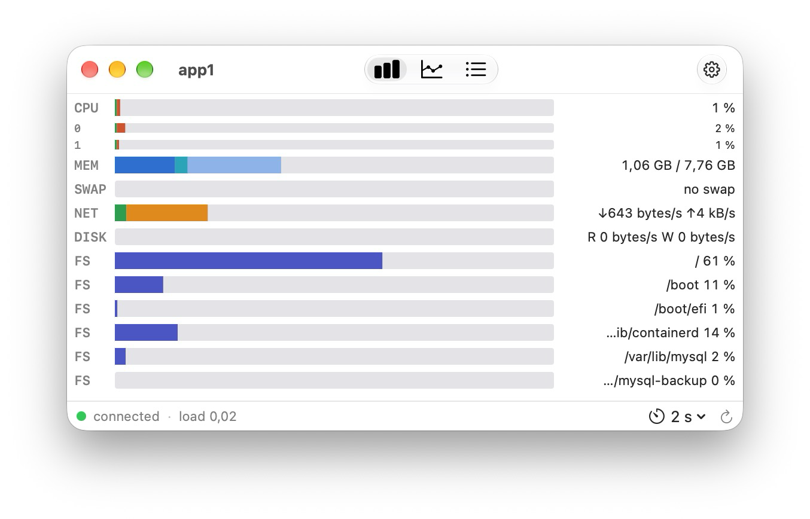
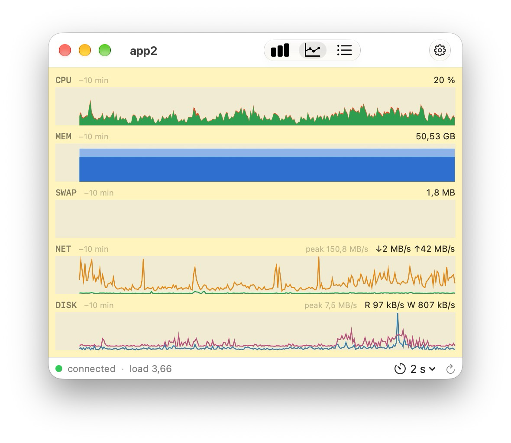
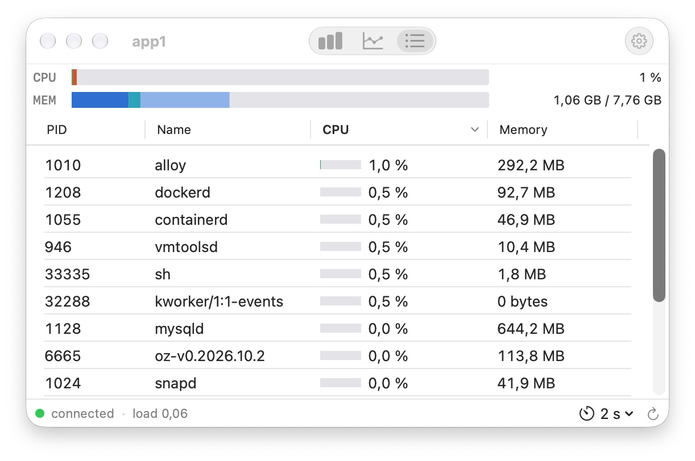
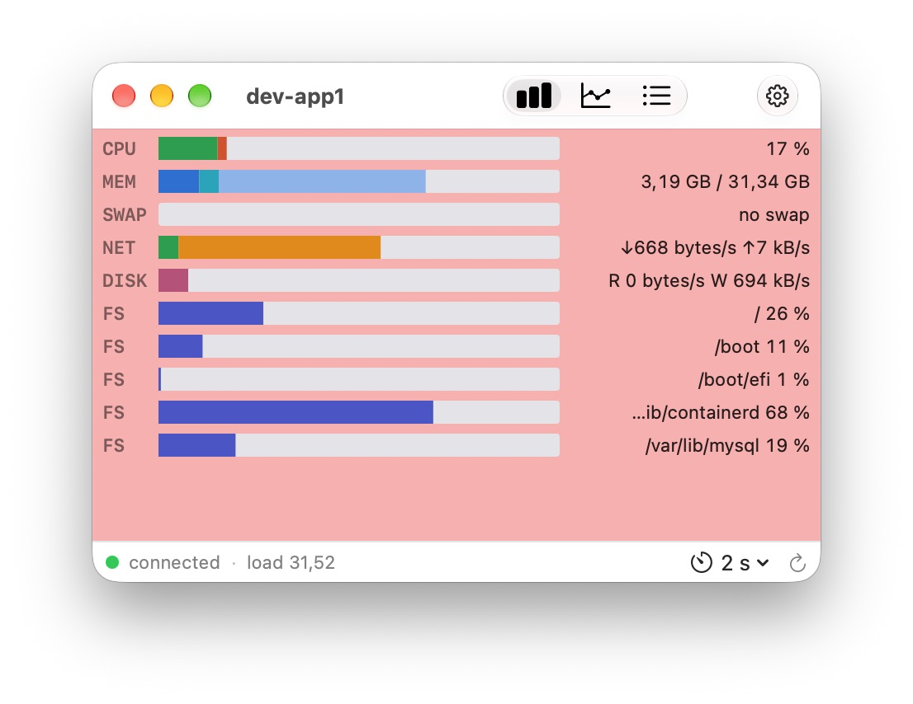
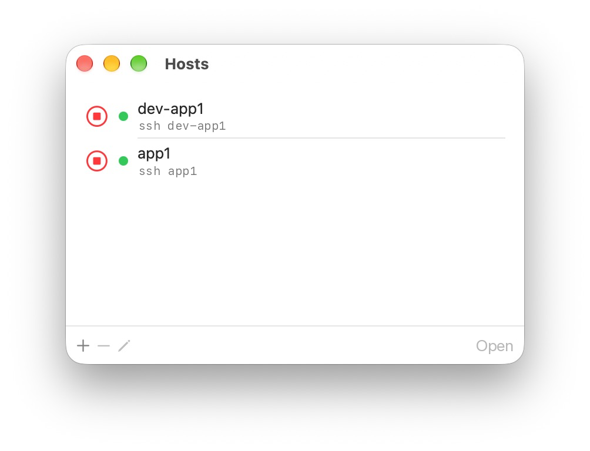

# Rosview

Native macOS app that monitors Linux servers over SSH, in the spirit of **xosview**: compact, segmented horizontal bars you can read at a glance.

<p align="center"></p>

- CPU, memory, swap, network, disk I/O and file systems
- Live bars, history graphs (2 to 30 min) and top processes
- Refresh interval from 1 s to 60 s
- Window background turns yellow, then red, as the load average nears a per-host threshold
- One window per host
- Nothing to install on the server: Rosview uses your Mac's `/usr/bin/ssh`, your keys and ssh-agent
- English and French

## Screenshots

**History** — graphs over the last 2 to 30 minutes, with the peak network and disk rates



**Top processes** — the 15 busiest processes, sorted by CPU or memory



**High load** — the window turns red when the load average reaches the host's threshold



**Hosts** — each host is just a name and an `ssh` command



## Install

With [Homebrew](https://brew.sh):

```sh
brew tap cbrassel/tap
brew trust cbrassel/tap   # Homebrew 7 and later
brew install --cask rosview
```

Or download the latest `Rosview-x.y.dmg` from [Releases](../../releases), open it and drag **Rosview** into **Applications**.

The app is signed with a Developer ID and notarized by Apple.

## Requirements

- macOS 14 or later
- A Linux server reachable with `ssh` using key or ssh-agent authentication (no passwords are stored)

## Feedback

Please open an [issue](../../issues).
